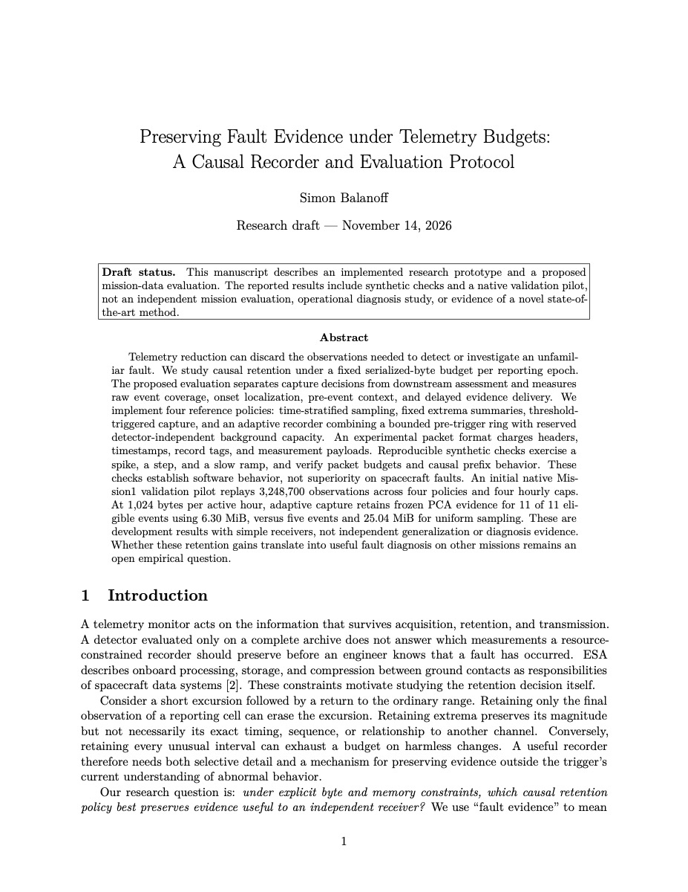
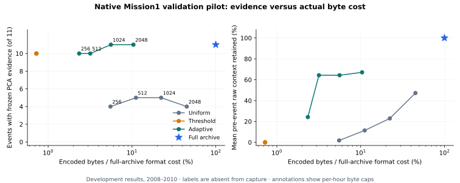

# Preserving Fault Evidence under Telemetry Budgets

**Simon Balanoff · Research draft · C++20 and Python**

[Read the paper](paper/draft.pdf) · [LaTeX source](paper/main.tex) ·
[Results and limitations](docs/results/native-retention.md) · [Reproduce](#reproduce-the-study)

Spacecraft telemetry reduction can discard the observations needed to investigate
a fault. This project studies **which native measurements and surrounding context
to retain under a fixed byte budget**, before the nature of a fault is known.

<a href="paper/draft.pdf"></a>

## Research approach

The recorder combines a bounded pre-trigger buffer, post-trigger capture, and
capacity reserved for background observations selected independently of anomaly
scores. Every packet charges its headers, timestamps, record tags, and values.
Uniform sampling, fixed summaries, and threshold-only capture provide comparisons.


Capture never receives event annotations. Receivers are calibrated on eligible
training observations, frozen across policies, and evaluated on decoded packets.
The implementation retains original timestamps rather than treating forward-filled
values as raw evidence.

## Initial native-data results

The development study replays **3,248,700 Mission1 observations from 2008–2010**
across four recording policies and four hourly byte caps. Receiver calibration
uses **8,713,221 eligible native training observations** from before 2008.

At a **1,024-byte cap per active hour**:

| Capture policy | Actual packet bytes | Events with frozen PCA evidence |
| --- | ---: | ---: |
| Uniform sampling | 25.04 MiB | 5 / 11 |
| Threshold-only | 0.81 MiB | 10 / 11 |
| Adaptive recorder | 6.30 MiB | 11 / 11 |

Fixed summaries are evaluated separately: extrema provide coarse bucket evidence,
not raw samples suitable for the same PCA receiver. All policies share a budget
**cap**, not equal actual expenditure. The unconstrained full-archive format cost
is calculated as 112.34 MiB.



These are preliminary results on **11 validation events**. They do not establish
novelty, improved physical diagnosis, or generalization to another mission. Positive
observations outside annotated events, event-level details, summary evidence, and
configuration hashes are reported in the [full study](docs/results/native-retention.md).
The previously examined Mission1 test split is not used in this pilot.

## Reproduce the study

Requires Python 3.12 or compatible, NumPy/pandas, and trusted official ESA Mission1
archives. See the [data guide](docs/data-pipeline.md) for preparation.

```bash
python -m pip install -r python/requirements-core.txt
python python/run_retention_pilot.py --output data/results/retention-native-reproduction
PYTHONPATH=python python -m unittest discover -s python/tests -v
```

The pilot verifies a hash-bound native cache against the existing grid export,
serializes packet streams, then evaluates them in a separate pass. Raw datasets
and large artifacts remain gitignored. Small results and generated manuscript
tables are tracked for review.

To rebuild the paper and README preview with Tectonic installed:

```bash
make -C paper preview
```

## Implementation and next experiments

The recorder is a Python research prototype. Supporting C++ components include
validated binary I/O, statistical/PCA detectors, numerical parity checks, a frame
pool, and a bounded queue. C++ recorder integration and flight deployment are not
claimed.

Next experiments are stronger adaptive/random sampling competitors, component
ablations, contact/loss simulation, and a frozen independent-mission evaluation.
The work targets evidence preservation; engineering review is still needed to
establish diagnostic usefulness.

[Protocol and implementation](docs/retention-research.md) ·
[Research plan](paper/research-plan.md) · [Development guide](docs/development.md) ·
[Claim/evidence ledger](paper/claims.md)
