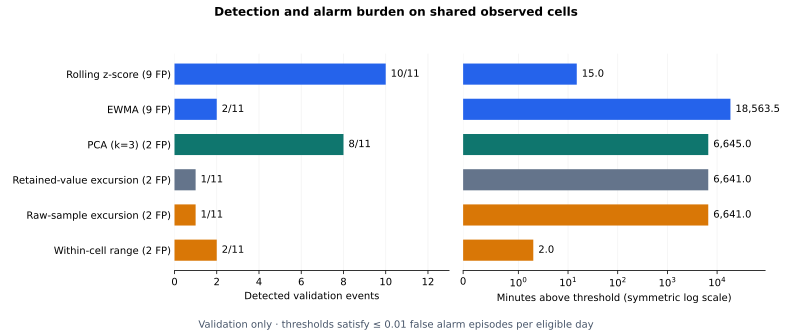

# Historical detector results and current retention studies

The current Python research results are the [native pilot](native-retention.md),
[seeded sampling comparison](randomized-retention.md), and
[component ablations](ablation-retention.md). The [Python-only source check](m1-source-validation.json)
verifies the full export without a native runtime.

The M1/M2 and detector-comparison artifacts below are historical. Their C++ runtime
and commands are available in the [pre-removal revision](https://github.com/simonbalanoff/telemetry-anomaly-engine/tree/2eda2af0a9ec9b67a0bb1aa03d1119081181461d); use that revision
in a separate checkout to reproduce them. They are not current pipeline dependencies.


These small artifacts document a complete local run on ESA-ADB Mission1 channels
41–46. Raw data, binary frames, masks, and score arrays remain gitignored.

## M1: complete export verification

[m1-validation.json](m1-validation.json) records reference counts, file hashes,
quality-state counts, an independent vectorized full-source comparison, and an
independent full-file C++ scan. All 14,728,320 exported frames match the expected
keep-last/forward-fill values bit for bit.

| State | Frames |
| --- | ---: |
| Observed | 14,642,408 |
| Forward-filled | 83,800 |
| Unavailable | 2,112 |

The bundle contains 1,255 event-channel intervals across 118 original event IDs.

## M2: frozen statistical baseline

The configuration is a 120-cell rolling window, EWMA alpha 0.05, and a normalized
rolling standard-deviation floor of 0.05. Normalization used 8,296,650 eligible
observed training cells. Validation selected thresholds of approximately
6.785716 for z-score and 46.391470 for EWMA.

| Partition | Detector | Detected / eligible events | Precision | Recall | F1 | False alarm episodes |
| --- | --- | ---: | ---: | ---: | ---: | ---: |
| Validation | Rolling z-score | 10 / 11 | 0.5000 | 0.9091 | 0.6452 | 10 |
| Validation | EWMA | 7 / 11 | 0.1628 | 0.6364 | 0.2593 | 36 |
| Test | Rolling z-score | 10 / 13 | 1.0000 | 0.7692 | 0.8696 | 0 |
| Test | EWMA | 6 / 13 | 1.0000 | 0.4615 | 0.6316 | 0 |

Test reporting was requested once after freezing the validation selection. Both
validation and test records appear in [m2-runs.jsonl](m2-runs.jsonl). The report
uses custom strict one-to-one event/episode matching, not the official ESA
hierarchical metric. Details are frozen in
[ADR 0003](../decisions/0003-statistical-baseline-and-evaluation.md).

Interpret these figures with their limits:

- There are only 13 test anomaly events. Recall intervals, individual matched IDs,
  and delay distributions are in the JSON reports; zero false alarms here does
  not imply a zero underlying false-alarm rate.
- Roughly 1.90% of test cells are excluded by labels, unavailable data, or warm-up.
  All 13 test anomaly events have at least one eligible scored cell.
- Long EWMA alarm episodes can cover substantial time. Alarm durations are
  reported separately from episode counts; the precision alone conceals this.
- The test period happens to score better than validation for these thresholds.
  This does not establish improvement on another mission or channel group.
- The current train/validation/test split has now been evaluated. Further changes
  examined on this same test period are exploratory.

Artifacts:

- [m2-selection.json](m2-selection.json): thresholds, validation candidates, provenance.
- [m2-validation.json](m2-validation.json): full validation report.
- [m2-test.json](m2-test.json): full held-out report.

## Reproduce the historical detector runs

Use the pre-removal revision linked above for these commands.

```bash
cmake --preset release
cmake --build --preset release --parallel
python python/convert_esa.py data/ESA-Mission1 --output data/processed/telemetry.bin
python python/verify_export.py data/ESA-Mission1 data/processed
python python/evaluate.py data/processed --output data/results/reproduction
python python/evaluate.py data/processed --output data/results/reproduction --test
```

A separately compiled executable normally has a different hash. Regenerate the
selection on validation using a fresh results directory rather than copying the
frozen selection from this run. Detector latency samples are local to macOS arm64
with AppleClang 21 release optimization; they exclude I/O and are not end-to-end
latency or portable performance guarantees.

## PCA and preserved-evidence comparison: validation only

The next experiment uses a common observed-cell mask and a budget of at most
0.01 false-alarm episodes per eligible normal day. It does not evaluate the test
partition again. A five-cell hold joins alarms only across short, usable missing
observations; missing cells receive no event-detection credit. About 2.106% of
validation cells are excluded or unscorable under this shared exposure policy.



| Detector | Detected / eligible events | False alarm episodes | Minutes above threshold, including held gaps |
| --- | ---: | ---: | ---: |
| Rolling z-score | 10 / 11 | 9 | 15.0 |
| EWMA | 2 / 11 | 9 | 18,563.5 |
| PCA, 3 retained components | 8 / 11 | 2 | 6,645.0 |
| Retained-value excursion | 1 / 11 | 2 | 6,641.0 |
| Raw-sample excursion | 1 / 11 | 2 | 6,641.0 |
| Within-cell range | 2 / 11 | 2 | 2.0 |

**Recommendation:** retain rolling z-score as the primary baseline. PCA offers a
lower false-alarm count here, with fewer detected events and much longer active
alarm time. Sustained anomalies can legitimately require sustained alarms; duration
needs operational interpretation, rather than being automatically good or bad.
The raw-extrema scores do not improve event detection over the matched retained
control at this budget. Synthetic regression tests nevertheless demonstrate that
the sidecar preserves a transient that the keep-last grid discards.

The [strict no-hold control](comparison-no-hold.json) uses the same scores, exposure,
and candidate-grid policy, with thresholds independently selected under the same
budget. It detects 10/11 events with 10 false alarms for z-score and 4/11 with zero
false alarms for the selected three-component PCA. The held-alarm improvement is
an alarm-management change, not an improvement in numerical PCA reconstruction.
Short observed below-threshold periods remain episode breaks.

Selection includes normal-score and all-score validation quantiles, including
extreme tails. This matters: considering only the normal-score tail can skip
useful thresholds above the maximum normal value and select silence instead.
The finite grid remains approximate. Candidate refinement and alarm-policy design
used validation only, so these figures are development results, not a new held-out
estimate. Multiple model/rank candidates increase validation-selection uncertainty.

Artifacts:

- [Feature manifest](cell-features-manifest.json): binds 14,728,320 raw count/extrema records to the verified telemetry file.
- [Comparison selection](comparison-selection.json): thresholds, all candidate trials, selected PCA rank, and dependency/configuration hashes.
- [Comparison report](comparison-validation.json): every PCA rank, controls, exposure, uncertainty, alarm duration, and scored/held cell counts.
- [Z-score alarms](comparison-zscore-alarms.json) and [PCA alarms](comparison-pca-alarms.json): inspectable episodes and channel context.

Reproduce with the [comparison workflow](../evidence-comparison.md). Matplotlib is
optional and is used only to render the SVG. The historical M1/M2 artifacts above
are preserved; their policy and exposure differ from this experiment.
