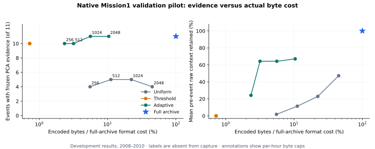

# Native Mission1 retention pilot

This is a **validation development study**, not a new held-out result. The prior
Mission1 test period remains untouched by this pilot. No deployment or novelty
claim is made.

## Data and fixed protocol

- Original Mission1 channels 41–46, before 30-second aggregation or forward-fill.
- All 15,381,169 native observations were cached with archive/array SHA-256 hashes;
  occupied-cell last values and occupancy were checked against the verified grid.
- Fit: 8,713,221 eligible native observations before 2008, excluding any selected
  channel's anomaly, rare-event, or communication-gap intervals.
- Replay: [2008-01-01, 2011-01-01) UTC; 3,248,700 observations and 26,304 active hours.
- Four caps: 256, 512, 1,024, and 2,048 application bytes per active hour.
- Adaptive configuration: eight prior samples, four post-trigger samples, 20%
  background reservation rounded up to a whole record. No future budget borrowing.
- Capture: maximum absolute first difference in frozen training standard-deviation
  units; threshold 6. Differences reset after gaps longer than 150 seconds.
- Receivers: frozen training-reference deviation and three-component PCA residual,
  each thresholded strictly above its eligible-training 0.999 quantile. Shared
  normalization does not imply fully independent modeling assumptions; receiver
  scores differ from the capture score and remain fixed across arms.
- Context metric: available eligible source observations in the 300 seconds before
  original event onset. No annotation is supplied to capture.

Byte files contain concatenated canonical TAER packets with **no extra uncharged
container framing**. Headers and record prefixes are included. Every arm emits
one packet per active hour, including empty threshold packets. All 16 streams were
decoded and checked against original timestamp/value bits; summaries were checked
against their true native source buckets.

## Results at the 1,024-byte hourly cap

| Policy | Actual MiB | Raw events retained | Level evidence | PCA evidence | Mean pre-event context retained |
| --- | ---: | ---: | ---: | ---: | ---: |
| Uniform | 25.04 | 5 / 11 | 5 / 11 | 5 / 11 | 22.9% |
| Summaries | 24.88 | 0 / 11 | unsupported on raw receiver | unsupported on raw receiver | 0% raw |
| Threshold-only | 0.81 | 10 / 11 | 10 / 11 | 10 / 11 | 0% |
| Adaptive | 6.30 | 11 / 11 | 11 / 11 | 11 / 11 | 64.3% |

The adaptive stream uses approximately 5.60% of the calculated full-archive format
cost of 112.34 MiB. The reference includes raw record and epoch-header costs but
was calculated from the schema, not serialized as a fifth stream.



At 256 and 512 bytes, adaptive capture retains raw observations from all 11 events,
but PCA evidence appears in 10; at 1,024 and 2,048 it appears in 11. Uniform results
are not monotonic in cap because deterministic time strata change phase: the
2,048-byte arm captures fewer point events than the 1,024-byte arm. This motivates
randomized/phase sensitivity controls before any superiority claim.

## Interpretation limits

- All 11 events have at least one eligible native source observation. Losing an
  event during capture counts as a miss in the same denominator for every arm.
- Global receiver evidence is a positive score on an original annotated sample,
  not verified channel-level root cause, event precision, or physical diagnosis.
- The frozen PCA receiver also produces **1,848 positive normal observations** in
  the adaptive 1,024-byte stream, versus 6,708 for uniform and 12,425 on the full
  archive. These are observation counts, not deduplicated alarm episodes, and the
  arms score different numbers of normal observations. They must not be described
  as controlled operational false-alarm rates.
- Summary extrema overlap all 11 annotated events at bucket resolution in this
  pilot. This can associate a bucket's unrelated extremum with an event and is
  reported separately, not as precise raw receiver recall.
- Epoch-end delivery is an idealized batching model. Native timestamps do not
  establish realistic communication latency, loss behavior, or onboard resource use.
- Eleven validation events, shared training normalization, pre-existing work on
  this mission, and a finite configuration sweep limit scientific conclusions.
  Stronger competitors, ablations, event-level uncertainty, and independent mission
  evaluation remain necessary.

## Reproducibility

[Full report and per-event details](native-retention.json) includes archive/cache
hashes, script hashes, receiver parameters, every arm's configuration, decoded
stream hashes, actual costs, context/onset/delivery metrics, and normal-positive
observation counts. Large streams remain under the gitignored results directory.

```bash
python python/run_retention_pilot.py --output data/results/retention-native-reproduction
python python/plot_retention_pilot.py data/results/retention-native-reproduction/report.json
```

The first run builds a native cache from trusted source archives. Reuse checks
source and array hashes; a changed cache identity requires a new cache directory.
Existing output directories are rejected to protect completed experiment artifacts.
No command in this workflow evaluates the historical test partition.
