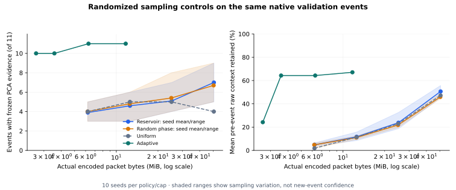

# Seeded reservoir and randomized-phase comparisons

This study adds two detector-independent controls to the native Mission1 pilot.
It reuses the **same 3,248,700 validation observations, 11 source-eligible events,
receiver parameters, thresholds, context window, epoch duration, and byte caps**.
There is no refitting, threshold selection, or historical test-partition evaluation.

## Policies and fixed randomization

- **Reservoir:** Algorithm R maintains a uniform sample without replacement of
  up to `floor((cap - 32) / 36)` observations per epoch. Its bounded buffer can
  replace a previous candidate before epoch-end delivery. It does not know the
  future epoch observation count.
- **Randomized uniform:** each epoch draws one phase offset and shifts all its
  evenly spaced targets by that fraction of a stratum. It captures the first
  available observation at or after each target. Gaps can skip targets; a sample
  is never duplicated, and an unavailable final target leaves unused budget.
- Seeds **0–9** are all reported at caps **256, 512, 1,024, and 2,048 bytes/hour**:
  80 randomized arms in total.
- Each epoch's Python `Random` generator is initialized from SHA-256 of
  `policy:seed:epoch_start`. The budget is omitted to couple the arms across caps.
  Results across caps are therefore not independent; retained sets need not be nested.
- The original uniform, threshold-only, and adaptive controls are reused only after
  verifying dataset/cache identities, receiver-file equality, evaluation source
  hashes, and every original packet-stream hash.

[Reservoir-sampling reference](https://doi.org/10.1145/3147.3165): Jeffrey S. Vitter,
*Random sampling with a reservoir*, ACM TOMS 11(1), 37–57 (1985). The implementation
uses Algorithm R, not the paper's faster Algorithm Z.

## Results at the 1,024-byte hourly cap

| Policy | Actual MiB | Frozen PCA evidence: events of 11 | Mean pre-event context retained |
| --- | ---: | ---: | ---: |
| Original uniform | 25.04 | 5 | 22.9% |
| Reservoir, ten seeds | 25.15 mean | 5.1 mean; range 4–7 | 23.8% mean |
| Randomized phase, ten seeds | 24.96 mean | 5.4 mean; range 4–8 | 21.8% mean |
| Original threshold-only | 0.81 | 10 | 0% |
| Original adaptive | 6.30 | 11 | 64.3% |



The adaptive result remains favorable against these controls on this archive.
The controls use the same **cap**, not the same actual expenditure: adaptive
capture is selective and leaves much of its allowance unused. The threshold-only
control spends less still and misses one event, illustrating a cost/evidence tradeoff.

The 1,024-byte reservoir streams contain 8,016–8,125 positive normal PCA
observations; randomized phase contains 6,728–6,890. The original adaptive stream
contains 1,848. These are observation counts with differing scored exposure,
not operational false-alarm episode rates or evidence of calibrated guarantees.

## What the seed range does and does not establish

The mean/range describes sampling variation on **the same 11 events**. Ten seeds
do not create 110 independent faults. Shaded figure ranges are observed minima
and maxima, not 95% confidence intervals or estimates of generalization uncertainty.
The adaptive policy itself remains deterministic, including its background phase.
Randomizing that phase and ablating its components are still useful next controls.

Longer annotated intervals are retained consistently by the random controls;
short events account for much of the variation. Per-event seed frequencies are
available in the report. Global receiver evidence still does not establish physical
diagnosis, true channel attribution, or novelty against all adaptive acquisition methods.

## Reproduce

First reproduce the native pilot, then reference that completed output:

```bash
python python/run_retention_pilot.py --output data/results/native-reproduction
python python/run_retention_randomized.py --baseline data/results/native-reproduction --output data/results/randomized-reproduction
python python/plot_retention_randomized.py data/results/randomized-reproduction/report.json
```

The default comparison uses four worker processes, one per cap; use `--workers 1`
for serial replay. All capture tasks finish before any evaluation task receives
annotations. Serialized streams have no extra container bytes. Decoding verifies
original timestamps/measurement bits, packet caps, and active-epoch counts.

[Tracked report](randomized-retention.json) includes every compact seed outcome,
per-event frequencies, frozen-model/source provenance, original-control results,
and packet hashes. Detailed decoded arm reports and large streams remain under
the gitignored experiment directory. Existing nonempty output directories are rejected.
